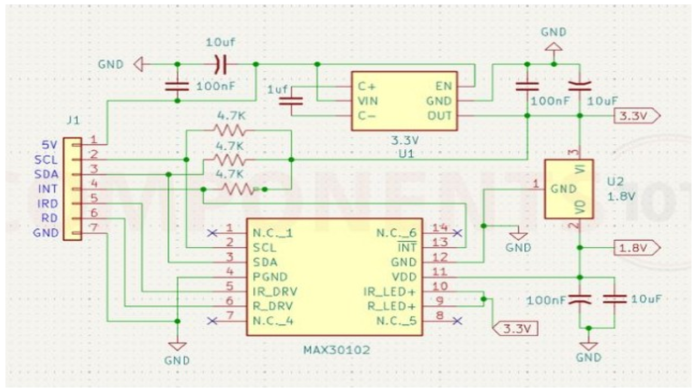
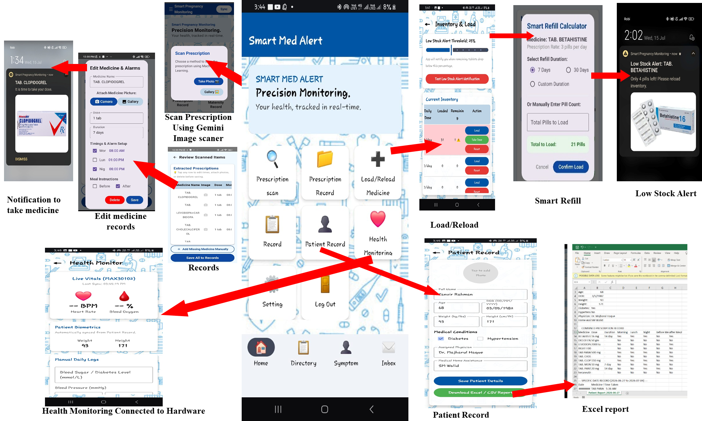
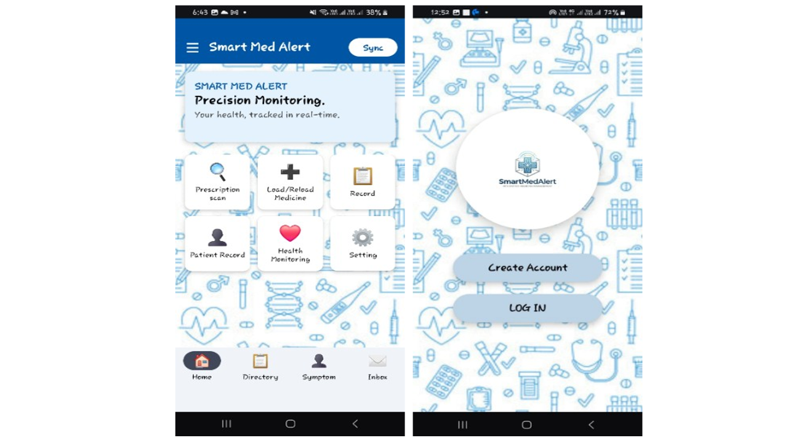
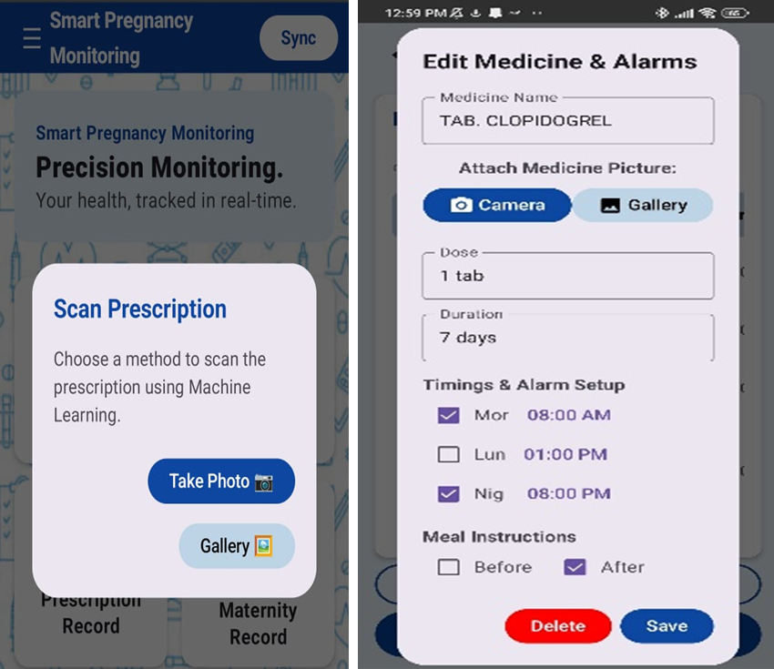
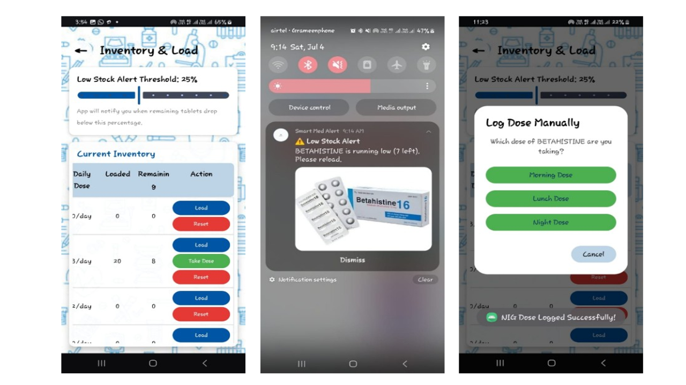
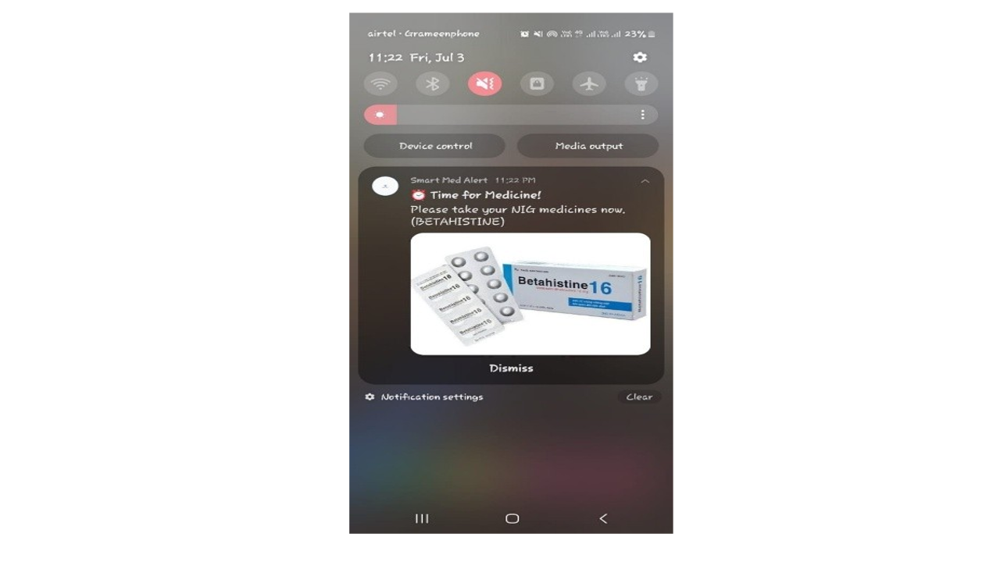

# Smart Medicine Box with Integrated Adherence Monitoring, Caregiver Alert System, and Modular Health Tracking

[]()
[]()
[](LICENSE)

Official repository for the **Smart Medicine Box and Adherence Monitoring System**[cite: 32]. This project presents an affordable, IoT-enabled smart medicine box designed to improve medication compliance for chronic disease management through automated compartment-level reminders, real-time sensor verification, ML-driven prescription OCR, cloud synchronization, and caregiver alerting[cite: 32].

---

## 📌 Abstract

Medication non-adherence remains one of the most persistent challenges in chronic disease management, contributing significantly to treatment failure, avoidable hospitalizations, and increased healthcare costs[cite: 32]. Despite advances in digital health, most existing medication management systems either provide simple reminders or are too expensive for household use (often ranging from $18,000 to $40,000 per unit for hospital-grade smart cabinets)[cite: 32]. 

This project bridges the gap by delivering a low-cost ($18–$25 base BOM) smart medicine box that integrates adherence monitoring, caregiver alerting, and optional health tracking into a unified system[cite: 32]. The proposed device combines real-time medication reminders with compartment-level visual and auditory indicators, along with sensor-based verification of drawer access[cite: 32]. Furthermore, the architecture supports modular integration of Bluetooth/Wi-Fi-enabled health monitoring devices, allowing time-synchronized correlation between medication adherence and physiological measurements such as heart rate and oxygen saturation[cite: 32].

---

## 🏗️ System Architecture

The Smart Medicine Box system is developed using a modular, decentralized, three-tier IoT architecture consisting of an Edge Node (ESP32 microcontroller), Cloud Infrastructure (Google Firebase), and a Client Application (Android native application)[cite: 32]. 


*(High-level conceptual overview showing patient, mobile app, nurse module, and physician interaction)[cite: 31, 35].*

This topology guarantees elevated fault tolerance, asynchronous communication, and real-time synchronization[cite: 32]. The system is designed for offline operation to ensure reliability in low-connectivity environments while maintaining cloud synchronization when available[cite: 32].


*(Detailed operational flowchart of the ESP32 controller, demonstrating the dual-core FreeRTOS multitasking and triple-input modalities)[cite: 31, 35].*

---

## ⚙️ Hardware Design & Integration

At the core of the system lies the **ESP32-WROOM** microcontroller, selected for its dual-core processor which allows parallelized high-frequency biometric sampling without interrupting asynchronous Wi-Fi communication[cite: 32]. The hardware logic operates at 3.3V logic levels and interfaces with physical switches, LED indicators, and biometric sensors[cite: 32].

### Physical Prototype & Hardware Layout

*(Assembled multi-compartment medicine storage unit with tactile switches and bi-color LED indicators)[cite: 31, 35].*


*(Experimental breadboard layout and microcontroller wiring integration with the MAX30102 sensor)[cite: 31, 35].*

### Circuit Schematics
To prevent current draw from exceeding the ESP32's maximum limit, compartment indicator LEDs are placed in series with $220\Omega$ current-limiting resistors[cite: 32]. Furthermore, the hardware utilizes the ESP32's internal `INPUT_PULLUP` circuitry for the mechanical lid switches to monitor patient compliance[cite: 32].


*(Circuit schematics detailing ESP32 pinouts, physical switch connections, and LED matrices)[cite: 31, 35].*


*(Internal circuit diagram for the MAX30102 high-sensitivity pulse oximeter and heart rate sensor module)[cite: 31, 35].*

---

## 📱 Mobile Application (`Smart Med Alert`)

The Android companion application provides a comprehensive interface for patients and caregivers to manage prescriptions, monitor inventory, receive alerts, and log daily health vitals[cite: 32].

### 1. Setup & Dashboard
The app features a secure login and an intuitive home dashboard for navigating medication schedules and patient records.




### 2. Machine Learning Prescription Extraction (OCR)
To eradicate manual data entry errors, the app incorporates an ML-driven prescription extraction workflow using Google ML Kit[cite: 32]. It parses numerical dosages, ingestion times, and matches extracted text against a local JSON medical lexicon using Levenshtein distance calculations[cite: 32].




### 3. Caregiver Alerts & Inventory Oversight
The system maintains a cloud-based ledger of pharmaceutical inventory. When a pill is consumed, the edge hardware records the NTP timestamp and updates Firebase[cite: 32]. The app issues Low Stock Alerts and physical alarm notifications (incorporating Android's `AlarmManager` to bypass Doze Mode latency)[cite: 32].




### 4. Vitals Monitoring & Clinical Reporting
The app synchronizes live vitals directly from the ESP32's MAX30102 sensor (Heart Rate and $\text{SpO}_2$)[cite: 32]. It consolidates this data alongside adherence history to generate exportable CSV/Excel reports for healthcare professionals to review[cite: 32].


---

## 💰 Bill of Materials (BOM) & Cost Comparison

| Component | Base Model (USD) | Premium Model (USD) |
| :--- | :---: | :---: |
| ESP32 Microcontroller | $5.56[cite: 32] | $10.00[cite: 32] |
| Drawer Detection (Reed Switches ×4) | $2.00[cite: 32] | $2.00[cite: 32] |
| LEDs & Resistors | $1.00[cite: 32] | $1.00[cite: 32] |
| MAX30102 Sensor | $5.00[cite: 32] | $5.00[cite: 32] |
| Power Supply & Battery | $14.00[cite: 32] | $14.00[cite: 32] |
| Enclosure | $5.00[cite: 32] | $5.00[cite: 32] |
| **Total Bill of Materials** | **$32.56**[cite: 32] | **$37.00**[cite: 32] |

---

## 📂 Repository File Structure

```text
├── Final - Smart Medicine Box...docx   # Complete technical research document & specification[cite: 32]
├── Mobile_App/                         # Android Studio source files for Smart Med Alert
├── download/                           # Auxiliary firmware binaries and dependencies
├── alert.png                           # Caregiver alert and escalation UI[cite: 35]
├── android_app_setup.png               # Complete app flowchart mapping[cite: 35]
├── core hardware.png                   # Prototype wiring and sensor interface[cite: 35]
├── hardware schematics.png             # Core logic and compartment circuitry[cite: 35]
├── heart monitoring.png                # Live biometric polling interface[cite: 35]
├── home.png                            # Main mobile application dashboard[cite: 35]
├── medicine database.png               # Daily history and dose tracking logic[cite: 35]
├── notofication.png                    # Inventory overview and manual override UI[cite: 35]
├── output results.png                  # Data consolidation and Excel CSV export[cite: 35]
├── overall box.png                     # Assembled physical prototype[cite: 35]
├── overall idea.png                    # High-level communication architecture[cite: 35]
├── overall workflow.png                # Firmware execution and decision flowchart[cite: 35]
├── scan.png                            # OCR-based prescription digitizer[cite: 35]
└── schematics.png                      # MAX30102 optical sensor schematic[cite: 35]
